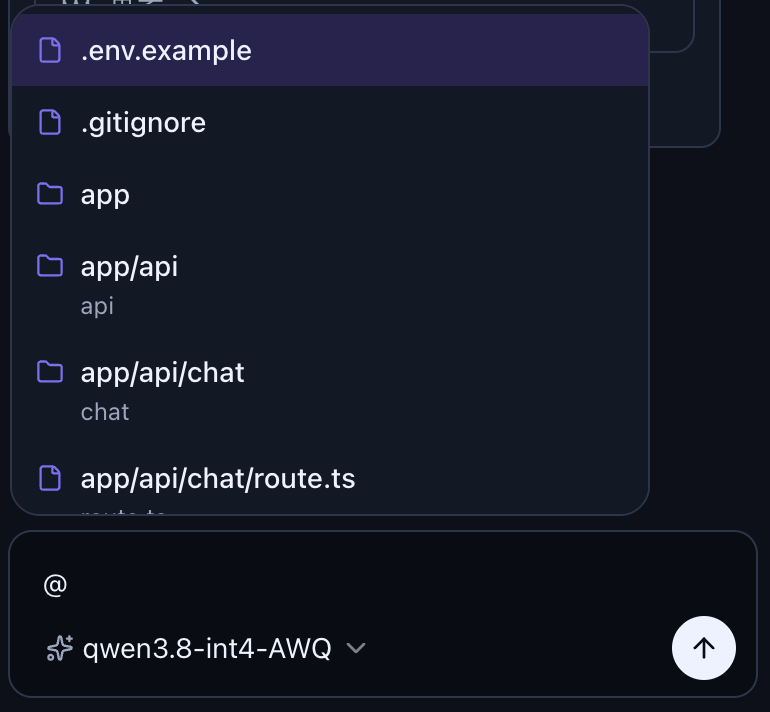
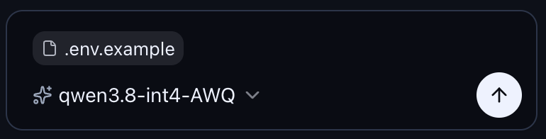
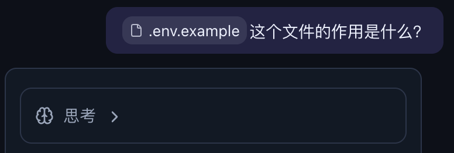
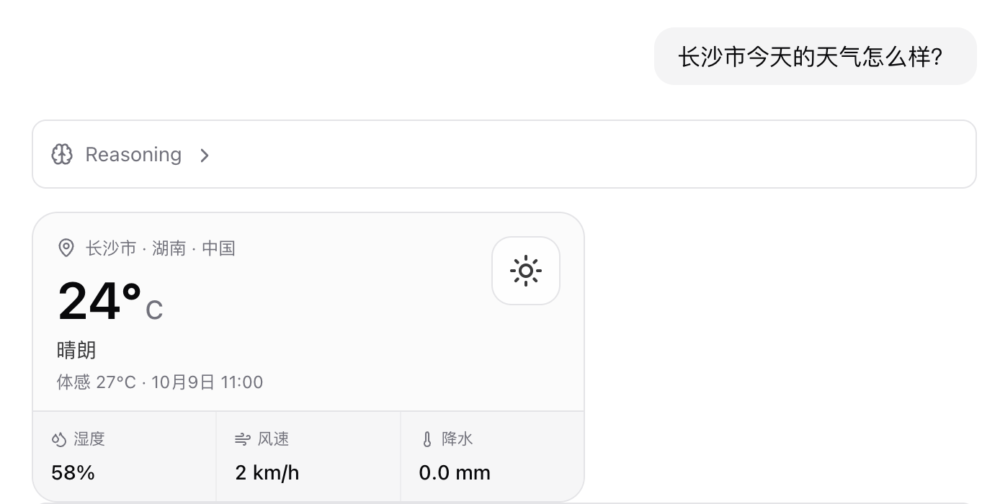
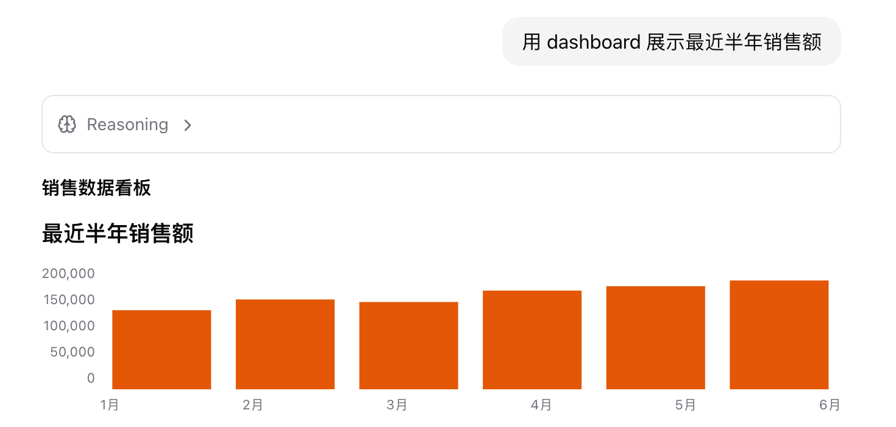
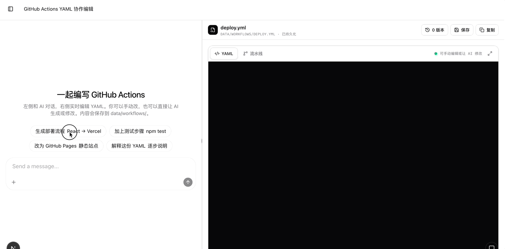

# Assistant-UI 进阶

上一篇 [Assistant UI - The composable AI chat UI toolkit](/2026/09/02/assistant-ui) 介绍了 Assistant UI 的整体架构、Primitives、Runtime，以及如何接入 AI SDK 构建一个可以流式对话的聊天界面。不过，基础对话只是起点：当聊天界面真正进入应用，还需要更自然的上下文引用、更快捷的指令入口、可视化的工具调用，以及需要用户参与的人机协作。

本篇在上一篇的基础上继续向前，依次介绍 Mentions、Slash Commands、工具、Generative UI 与 Interactables，让 Assistant UI 从一个「能聊天」的界面，逐步变成一个可以融入真实业务流程的智能助手。

## Mentions

Mentions 允许用户在输入框中键入 `@`，从弹出的候选列表中选择工具、用户、文件等对象。它不只是一个下拉框，而是由三个部分组成：

1. **Trigger**：监听 `@`，提取光标前的搜索词；
2. **Adapter**：提供分类、候选项和同步搜索；
3. **Formatter**：把选中的对象序列化为 directive，例如 `:file[src/app.tsx]`。

普通的 `ComposerPrimitive.Input` 会直接显示 directive 文本。使用 Lexical 后，directive 在输入框中会显示为不可拆分的 Chip，删除、选择和撤销时都作为一个整体处理，更适合 IDE 这类需要频繁引用文件的场景。

### 安装依赖 

首先添加 `@assistant-ui/composer-trigger-popover` 和 `@assistant-ui/directive-text` 组件

```sh
$ npx shadcn@latest add @assistant-ui/composer-trigger-popover @assistant-ui/directive-text
```

命令会把 `composer-trigger-popover.aui.tsx`、`directive-text.aui.tsx` 复制到项目中，可以继续修改样式和交互。

然后安装 `@assistant-ui/react-lexical` 以及相关依赖包

```sh
$ npm install @assistant-ui/react-lexical lexical @lexical/react @lexical/utils @lexical/history @lexical/plain-text
```

### 在 IDE 中引用文件

以 Web IDE 为例，工作区已经有一棵文件树。用户在对话框中输入 `@agent` 时，希望看到路径中包含 `agent` 的文件。选择文件后，输入框显示一个文件 Chip，发送给 Agent 的消息则保留完整路径。

先把文件树节点转换成 Assistant-UI 可以识别的 Mention：

```tsx
import type { Unstable_Mention } from "@assistant-ui/react";

type FileNode = {
  path: string;
  name?: string;
  type: "file" | "directory";
};

const FILE_MENTION_ICON_MAP = {
  file: "File",
  directory: "Folder",
} as const;

function fileNodesToMentions(files: FileNode[]): Unstable_Mention[] {
  return files.map((item) => {
    const type = item.type === "directory" ? "directory" : "file";
    const name = item.name || item.path.split("/").pop() || item.path;

    return {
      id: item.path,
      type,
      label: item.path,
      description: name !== item.path ? name : undefined,
      icon: FILE_MENTION_ICON_MAP[type],
    };
  });
}
```

这里直接把 `path` 同时作为 `id` 和 `label`。路径不只是展示文本，也是 Agent 后续定位文件的稳定标识；`type` 则用于区分文件和目录。

接着用 `unstable_useMentionAdapter` 建立文件搜索 Adapter：

```tsx
import { useMemo } from "react";
import { unstable_useMentionAdapter } from "@assistant-ui/react";
import { FileIcon, FolderIcon } from "lucide-react";
import { ComposerTriggerPopover } from "@/components/assistant-ui/elements/composer-trigger-popover.aui";
import { useIdeStore } from "@/store/ide";

const MENTION_LIMIT = 50;

function FileMentionTrigger() {
  const files = useIdeStore((state) => state.files);
  const items = useMemo(() => fileNodesToMentions(files), [files]);
  const mention = unstable_useMentionAdapter({
    items,
    includeModelContextTools: false,
    iconMap: { File: FileIcon, Folder: FolderIcon },
    fallbackIcon: FileIcon,
  });

  const adapter = useMemo(
    () => ({
      categories: mention.adapter.categories,
      categoryItems: mention.adapter.categoryItems,
      search: (query: string) =>
        (mention.adapter.search?.(query) ?? []).slice(0, MENTION_LIMIT),
    }),
    [mention.adapter],
  );

  return (
    <ComposerTriggerPopover
      char="@"
      adapter={adapter}
      directive={mention.directive}
      iconMap={mention.iconMap}
      fallbackIcon={mention.fallbackIcon}
      emptyItemsLabel="没有匹配的文件"
      className="max-h-64 w-80 overflow-y-auto"
    />
  );
}
```

`items` 是当前工作区的文件快照，Adapter 的搜索方法是同步的，因此文件列表应先由接口加载到 Zustand、React Query 等外部状态中。这里最多展示 50 条结果，避免大型仓库一次渲染过多文件。

`includeModelContextTools: false` 表示这个弹窗只负责文件，不把已经注册的工具混入候选列表。

实现效果如下：



### 使用 Lexical Composer

把原来的 `ComposerPrimitive.Input` 替换成 `LexicalComposerInput`，并确保输入框和 Mention 弹窗位于同一个 `TriggerPopoverRoot` 中：

```tsx
import { ComposerPrimitive } from "@assistant-ui/react";
import { LexicalComposerInput } from "@assistant-ui/react-lexical";

<ComposerPrimitive.Unstable_TriggerPopoverRoot>
  <ComposerPrimitive.Root className="relative flex flex-col rounded-xl border p-2">
    <LexicalComposerInput
      aria-label="发送消息"
      placeholder="发送消息，输入 @ 提及文件…"
      directiveChip={LexicalFilePathChip}
      className="max-h-40 overflow-y-auto px-1.5 py-1 text-sm"
    />

    <FileMentionTrigger />
    <ComposerPrimitive.Send>发送</ComposerPrimitive.Send>
  </ComposerPrimitive.Root>
</ComposerPrimitive.Unstable_TriggerPopoverRoot>
```

`LexicalComposerInput` 会发现同一个 Root 下注册的 `Directive` Trigger。选择文件后，它不会把 directive 当作普通文字展示，而是交给 `directiveChip` 渲染：

```tsx
import { FileIcon, FolderIcon } from "lucide-react";

function LexicalFilePathChip({
  directiveId,
  directiveType,
  label,
}: {
  directiveId: string;
  directiveType: string;
  label: string;
}) {
  const Icon = directiveType === "directory" ? FolderIcon : FileIcon;

  return (
    <span
      className="mx-0.5 inline-flex items-center gap-1 rounded-md bg-foreground/10 px-1.5 py-0.5"
      data-directive-id={directiveId}
    >
      <Icon className="size-3" />
      <span>{label}</span>
    </span>
  );
}
```

实现效果如下：



Chip 只是编辑器中的视觉表现，Composer 保存的仍是普通文本。以上面的文件为例，实际发送内容类似：

```text
请检查 :file[src/components/ide/agent-panel.tsx] 中的会话切换逻辑
```

默认格式是 `:type[label]{name=id}`；当 `id` 和 `label` 相同时，`{name=...}` 会被省略。这样消息可以正常持久化和传输，不需要让后端理解 Lexical 的内部数据结构。

### 在消息中还原 Chip

发送以后，用户消息也要把 directive 渲染为 Chip，否则会直接看到 `:file[...]`。使用 CLI 添加的 `createDirectiveText` 创建文本渲染器：

```tsx
import {
  MessagePrimitive,
  unstable_defaultDirectiveFormatter,
} from "@assistant-ui/react";
import { createDirectiveText } from "@/components/assistant-ui/elements/directive-text.aui";

const FileDirectiveText = createDirectiveText(
  unstable_defaultDirectiveFormatter,
);

<MessagePrimitive.Parts
  components={{ Text: FileDirectiveText }}
/>;
```

Composer 和消息渲染必须使用同一个 Formatter，否则一端生成的 directive 可能无法被另一端解析。

实现效果如下：



### 从文件树直接插入

除了输入 `@` 搜索，IDE 还可以在文件树的右键菜单中提供「添加到对话」。菜单把文件路径写入共享状态，对话面板再调用 Composer API 插入 directive：

```tsx
import {
  unstable_defaultDirectiveFormatter,
  useAui,
} from "@assistant-ui/react";

function InsertFileButton({
  path,
  type,
}: {
  path: string;
  type: "file" | "directory";
}) {
  const aui = useAui();

  const insertMention = () => {
    const directive = unstable_defaultDirectiveFormatter.serialize({
      id: path,
      type,
      label: path,
    });
    const current = aui.composer.getState().text.trimEnd();
    aui.composer.setText(
      current ? `${current} ${directive} ` : `${directive} `,
    );
  };

  return <button onClick={insertMention}>添加到对话</button>;
}
```

这条路径绕过了弹窗选择，但 Formatter、Lexical Chip 和消息渲染仍然复用同一套机制。

最后需要注意，Mention **只引用对象，不会自动读取文件内容**。后端收到的是带路径的 directive：如果接入的是 Coding Agent，它可以根据路径调用文件读取工具；如果只是普通 LLM，则需要在服务端解析 directive，读取对应文件并把内容加入模型上下文。不要把客户端传来的路径直接交给文件系统，服务端仍需检查路径是否属于当前工作区。

## 工具

工具让模型不再局限于生成文字，而是可以查询天气、访问数据库、操作浏览器或暂停等待用户输入。Assistant-UI 负责把工具的 Schema、执行逻辑和 React UI 接到 Runtime；真正决定是否调用工具的仍然是模型。

### 定义工具的方式

Assistant-UI 当前推荐使用 `"use generative"` 与 `defineToolkit` 定义工具。它是一种主要的组织方式，再根据 `execute` 的写法推断工具在哪里执行：

- **Backend Tool**：`execute` 是普通异步函数，在服务端调用数据库或第三方 API；
- **Frontend Tool**：`execute` 内以 `"use client"` 开头，在浏览器中访问剪贴板、地理位置等客户端能力；
- **Human Tool**：使用 `humanTool()`，渲染表单或选择器，并等待用户通过 `addResult` 提交结果；
- **Provider Tool**：使用 `providerTool()`，接入 OpenAI Web Search 等由模型 Provider 执行的工具；
- **External Tool**：使用 `externalTool()`，工具由 LangGraph、其他后端或外部 Agent 执行，Assistant-UI 只负责渲染；
- **Dynamic Tool**：先用 `stubTool()` 声明契约，再通过 `useAuiToolOverrides` 注入依赖 React state 的执行函数；
- **MCP Tool**：使用 `defineMcpToolkit()` 把 MCP Server 提供的工具合并进 Toolkit。

如果项目不能使用 generative compiler，也可以创建普通的 `defineToolkit`，显式填写 `type: "backend"` 并只注册 `render`。

### `"use generative"`

`"use generative"` 让 Schema、执行函数和 UI 写在同一个文件中，编译时再按客户端和服务端拆分。下面定义一个 `get_weather`：模型传入城市和温度单位，服务端查询天气，浏览器把结果渲染成天气卡片。

#### 安装依赖

Next.js 项目需要安装 Assistant-UI 的编译插件；`zod` 用于定义模型可以看到的参数 Schema：

```sh
$ npm install @assistant-ui/react @assistant-ui/ai-sdk @assistant-ui/next ai zod
```

在 `next.config.ts` 中启用编译器：

```ts
import { withAui } from "@assistant-ui/next";

export default withAui({
  // 其他 Next.js 配置
});
```

#### 定义 Toolkit

创建 `app/tools/weather.tsx`。文件第一行必须是 `"use generative"`，并默认导出 `defineToolkit`：

```tsx
"use generative";

import { defineToolkit } from "@assistant-ui/react";
import { z } from "zod";

export default defineToolkit({
  get_weather: {
    description: "查询指定城市当前的天气",
    parameters: z.object({
      location: z.string().describe("城市名称，例如 Changsha"),
      unit: z.enum(["celsius", "fahrenheit"]).default("celsius"),
    }),
    display: "standalone",
    execute: async ({ location, unit }) => {
      const response = await fetch(
        `https://wttr.in/${encodeURIComponent(location)}?format=j1`,
        { signal: AbortSignal.timeout(10_000) },
      );
      if (!response.ok) {
        throw new Error(`天气服务返回 ${response.status}`);
      }

      const data = await response.json();
      const current = data.current_condition?.[0];
      if (!current) throw new Error(`没有找到 ${location} 的天气`);

      return {
        location,
        temperature: Number(
          unit === "celsius" ? current.temp_C : current.temp_F,
        ),
        unit,
        condition: current.weatherDesc?.[0]?.value ?? "未知",
        humidity: Number(current.humidity),
        windSpeed: Number(current.windspeedKmph),
      };
    },

    render: ({ args, result, status }) => {
      if (status.type === "running") {
        return <div className="rounded-xl border p-4">正在查询 {args.location} 的天气…</div>;
      }

      if (status.type === "incomplete") {
        return <div className="rounded-xl border p-4 text-red-500">天气查询失败</div>;
      }

      if (!result) return null;

      return (
        <section className="my-3 rounded-xl border bg-sky-50 p-4 text-sky-950">
          <h3 className="text-lg font-semibold">{result.location}</h3>
          <p className="mt-2 text-3xl font-bold">
            {result.temperature}°{result.unit === "celsius" ? "C" : "F"}
          </p>
          <p>{result.condition}</p>
          <div className="mt-3 flex gap-4 text-sm">
            <span>湿度 {result.humidity}%</span>
            <span>风速 {result.windSpeed} km/h</span>
          </div>
        </section>
      );
    },
  },
});
```

这里没有在 `execute` 中写 `"use client"`，所以编译器会把它识别为 Backend Tool：

- 服务端构建保留 `description`、`parameters` 和 `execute`；
- 客户端构建保留 Schema、`display` 和 `render`；
- 服务端不会打包天气卡片，浏览器也不会拿到工具执行逻辑。

如果天气服务需要 API Key，把它放在 `execute` 读取的服务端环境变量中，不要为了调用接口而给 `execute` 添加 `"use client"`。

#### 单独显示 Tool UI

```tsx
display: "standalone"
```

Backend Tool 默认以内联方式出现在工具调用组中，思考链折叠时也会一起收起。`display: "standalone"` 会让天气卡片脱离折叠的 Tool Group，作为一块独立 UI 留在消息流中。

天气、图表、表单和审批这类需要用户直接查看或操作的结果适合 standalone；读取文件、搜索索引等过程型工具通常保留默认内联显示即可，否则一次 Agent 运行会产生大量卡片。

#### 在客户端注册

客户端通过 `Tools` 把 Toolkit 注册到 Runtime：

```tsx
"use client";

import {
  AssistantRuntimeProvider,
  AuiConfig,
  Tools,
} from "@assistant-ui/react";
import { useChatRuntime } from "@assistant-ui/ai-sdk";
import weatherToolkit from "@/app/tools/weather";

export function MyRuntimeProvider({
  children,
}: {
  children: React.ReactNode;
}) {
  const runtime = useChatRuntime();
  const config = AuiConfig({
    tools: Tools({ toolkit: weatherToolkit }),
  });

  return (
    <AssistantRuntimeProvider runtime={runtime} config={config}>
      {children}
    </AssistantRuntimeProvider>
  );
}
```

客户端注册负责执行 Frontend Tool 和渲染 Tool UI，但仅在客户端注册还不够：模型运行在服务端，必须让 API Route 也获得同一份工具 Schema。

#### 暴露给模型

API Route 导入同一个文件时，generative compiler 会自动选择它的服务端版本。`AISDKToolkit` 把 Schema 和 Backend Tool 的 `execute` 转换为 AI SDK Tools：

```ts
import { openai } from "@ai-sdk/openai";
import { AISDKToolkit } from "@assistant-ui/ai-sdk";
import {
  convertToModelMessages,
  stepCountIs,
  streamText,
} from "ai";
import weatherToolkit from "@/app/tools/weather";

const tools = new AISDKToolkit({ toolkit: weatherToolkit });

export async function POST(request: Request) {
  const {
    messages,
    system,
    tools: frontendTools,
  } = await request.json();

  const result = streamText({
    model: openai("gpt-5.4-mini"),
    system,
    messages: await convertToModelMessages(messages),
    tools: await tools.tools({ frontend: frontendTools }),
    stopWhen: stepCountIs(5),
  });

  return result.toUIMessageStreamResponse();
}
```

一次天气查询的过程是：模型生成 `get_weather` 调用 → 服务端执行 `execute` → 工具结果回到模型 → 客户端的 `render` 收到相同结果并更新天气卡片。`stopWhen` 允许模型在工具执行后继续生成总结，而不是在第一次 Tool Call 后结束。

#### 实现效果



## Generative UI

`"use generative"` 和 **Generative UI** 不是一回事：

- `"use generative"` 是编译 directive，解决 Schema、Executor 和 Renderer 如何跨客户端与服务端共置；上面的天气 Tool UI 是固定映射，`get_weather` 永远由开发者编写的天气卡片渲染；
- Generative UI 则由模型从应用提供的组件词汇表中选择组件，并在运行时组合布局。

例如面对销售数据，模型可以根据问题只展示几个 Fact，也可以组合 Card、Row、Chart 和 Table。模型输出的是受限 JSON 树，而不是任意 JSX。

### 安装依赖

安装 Generative UI 运行时，并添加官方样式组件：

```sh
$ npm install @assistant-ui/react-generative-ui
$ npx shadcn@latest add @assistant-ui/generative-ui
```

### 注册 `present` 工具

`JSONGenerativeUI` 把组件词汇表转换成一个模型可调用的 `present` 工具。官方默认词汇表包含 Card、Fact、Table、Chart、Form 等组件：

```tsx
"use generative";

import { defineToolkit } from "@assistant-ui/react";
import {
  defaultGenerativeUILibrary,
  JSONGenerativeUI,
} from "@assistant-ui/react-generative-ui";

const generativeUI = new JSONGenerativeUI({
  library: defaultGenerativeUILibrary,
});

export default defineToolkit({
  present: generativeUI.present({
    display: "standalone",
  }),
});
```

这里再次使用 `display: "standalone"`，让模型生成的界面作为独立内容展示，而不是藏在工具调用折叠区中。

### 与自定义工具合并

天气工具和 `present` 可以放在同一个 Toolkit 中，但随着工具增多，把它们分别定义再汇总更容易维护。假设目录结构如下：

```text
app/
└── tools/
    ├── weather.tsx
    ├── generative-ui.tsx
    └── index.ts
```

`weather.tsx` 是前面定义的 `get_weather`，`generative-ui.tsx` 默认导出 `present`。然后在 `index.ts` 中合并：

```ts
"use generative";

import { defineToolkit } from "@assistant-ui/react";
import generativeUITools from "./generative-ui";
import weatherTools from "./weather";

export default defineToolkit({
  ...weatherTools,
  ...generativeUITools,
});
```

每个被拆分的文件都要满足两个条件：

1. 第一行是 `"use generative"`；
2. 使用 `default export` 导出 `defineToolkit(...)`。

汇总文件也需要 `"use generative"`，并通过默认导入展开子 Toolkit。编译器会检查这些模块是否可以安全跨越客户端和服务端边界，也会在工具重名时给出警告。

合并后的 Toolkit 包含两个职责不同的工具：

- `get_weather` 获取可信的实时数据，属于 Backend Tool；
- `present` 根据已有数据组合界面，属于 Frontend Tool。

不要让 `present` 代替业务工具获取数据。它的参数由模型生成，适合描述布局，不应被当成天气、订单或数据库查询的事实来源。

### 前端接入

前端只需注册汇总后的 Toolkit。`present` 在浏览器完成渲染后会产生工具结果，需要再发送给模型才能继续对话，因此还要配置 `sendAutomaticallyWhen`：

```tsx
"use client";

import {
  AssistantRuntimeProvider,
  AuiConfig,
  Tools,
} from "@assistant-ui/react";
import { useChatRuntime } from "@assistant-ui/ai-sdk";
import { lastAssistantMessageIsCompleteWithToolCalls } from "ai";
import toolkit from "@/app/tools";

export function MyRuntimeProvider({
  children,
}: {
  children: React.ReactNode;
}) {
  const runtime = useChatRuntime({
    sendAutomaticallyWhen: lastAssistantMessageIsCompleteWithToolCalls,
  });
  const config = AuiConfig({
    tools: Tools({ toolkit }),
  });

  return (
    <AssistantRuntimeProvider runtime={runtime} config={config}>
      {children}
    </AssistantRuntimeProvider>
  );
}
```

浏览器拿到的是 Toolkit 的客户端构建：

- `get_weather` 保留天气卡片的 `render`，不包含服务端 `execute`；
- `present` 保留组件词汇表、执行逻辑和 Renderer；
- `Tools({ toolkit })` 把两者注册到当前 Runtime。

如果缺少 `sendAutomaticallyWhen`，`present` 仍然可以渲染，但运行会停在这次 Frontend Tool Call，模型不会继续生成后续说明。

### 后端接入

API Route 同样导入汇总后的 Toolkit。这里导入的是编译器生成的服务端版本，再由 `AISDKToolkit` 转换成 AI SDK Tools：

```ts
import { openai } from "@ai-sdk/openai";
import { AISDKToolkit } from "@assistant-ui/ai-sdk";
import {
  convertToModelMessages,
  stepCountIs,
  streamText,
} from "ai";
import toolkit from "@/app/tools";

const aiToolkit = new AISDKToolkit({ toolkit });

export async function POST(request: Request) {
  const {
    messages,
    system,
    tools: frontendTools,
  } = await request.json();

  const result = streamText({
    model: openai("gpt-5.4-mini"),
    system: `${system ?? ""}

Use domain tools to retrieve factual data.
Use present to visualize data that has no dedicated tool UI.`,
    messages: await convertToModelMessages(messages),
    tools: await aiToolkit.tools({
      frontend: frontendTools,
    }),
    stopWhen: stepCountIs(10),
  });

  return result.toUIMessageStreamResponse();
}
```

服务端构建中的内容与客户端相反：

- `get_weather` 保留 Schema 和 `execute`，所以天气请求只在服务端发生；
- `present` 保留模型需要的 Schema，但不包含浏览器 Renderer；
- `AISDKToolkit.tools()` 再把请求中上传的 Frontend Tools 与服务端工具合并。

`stopWhen` 和 `sendAutomaticallyWhen` 解决的是两段不同的续跑：前者允许服务端在 Backend Tool 返回后继续推理，后者允许浏览器执行完 `present` 后发起下一次请求。混合 Backend Tool 与 Frontend Tool 时，两者通常都需要。

假设应用定义了 `get_sales_summary`，用户说「汇总最近六个月的销售趋势，并生成仪表盘」，完整过程如下：

1. 模型调用 `get_sales_summary({ months: 6 })`；
2. 服务端查询数据库，把销售额、增长率和每月趋势交回模型；
3. 模型根据结果调用 `present`，生成 Card、Row、Fact 和 Chart 组成的 JSON；
4. 浏览器渲染独立的 Generative UI，并完成 Frontend Tool Call；
5. Runtime 自动提交工具结果，模型继续生成最终说明。

模型调用 `present` 时，会生成类似下面的 JSON：

```json
{
  "$type": "Card",
  "title": "近六个月销售概览",
  "children": [
    {
      "$type": "Row",
      "children": [
        { "$type": "Fact", "label": "销售额", "value": "¥1,280,000" },
        {
          "$type": "Fact",
          "label": "环比增长",
          "value": "12.4%",
          "trend": "up"
        }
      ]
    },
    {
      "$type": "Chart",
      "variant": "bar",
      "showAxis": true,
      "data": [
        { "label": "5月", "value": 168000 },
        { "label": "6月", "value": 182000 },
        { "label": "7月", "value": 195000 },
        { "label": "8月", "value": 211000 },
        { "label": "9月", "value": 238000 },
        { "label": "10月", "value": 286000 }
      ]
    }
  ]
}
```

`$type` 只能引用 Library 中允许的组件，属性还会经过对应的 Zod Schema 校验，未知组件不会被动态加载，也不会执行模型生成的代码。因此 Generative UI 的安全边界是**组件白名单 + Props Schema**。

### 实现效果



固定 Tool UI 更适合结构稳定、交互规则明确的业务组件，例如前面的天气卡片；

Generative UI 更适合仪表盘、数据摘要等布局会随回答变化的内容。

两者可以并存：`get_weather` 使用自己的 `render`，`get_sales_summary` 等数据型工具则把结果交给 `present` 组织展示。

## Interactable

Tool UI 通常围绕一次工具调用：模型传入参数，组件展示执行状态和结果。**Interactable** 则把 UI 变成一份由用户和 Agent 共同维护的状态：

- 用户通过 React 表单、编辑器等界面修改状态；
- Agent 通过自动生成的 `update_{name}` 工具修改同一份状态；
- 用户下一次发消息时，最新状态会作为 Snapshot 提供给模型；
- 每次用户编辑和 Agent 更新都会形成一个可恢复的版本。

Interactables 适合文档编辑器、任务看板、设置面板、Artifacts 等需要持续协作的界面。目前相关 API 仍带有 `unstable_` 前缀，升级 Assistant-UI 时需要留意变更。

### 两种 Interactable

Assistant-UI 提供两种作用域：

- **App-scoped**：应用主动挂载组件，通过 `unstable_useInteractable` 注册。它可以放在侧边栏或主内容区，并跨多个对话线程共享；
- **Thread-scoped**：模型调用 `unstable_interactableTool` 创建组件，组件出现在消息中，状态随当前 Thread 的消息历史保存。

下面以 GitHub Actions YAML 编辑器为例进行讲解。它属于 App-scoped Interactable。用户和 Agent 协作创建、修改流水线 YAML。

### 安装依赖

```sh
$ npm install @assistant-ui/react @assistant-ui/ai-sdk ai zod
```

### 定义共享状态

Interactable 的 Schema 同时约束 React 状态和模型可调用的更新工具。这个例子只维护文件名和完整的 YAML 内容：

```ts
import { z } from "zod";

// Schema 会同时生成 React 状态类型和 update_workflow 的参数结构。
export const workflowSchema = z.object({
  filename: z
    .string()
    .describe("GitHub Actions 文件名，例如 deploy.yml 或 ci.yml"),
  content: z
    .string()
    .describe("完整的 GitHub Actions workflow YAML 内容"),
});

export type WorkflowState = z.infer<typeof workflowSchema>;

// 首次打开且没有持久化数据时使用的默认值。
export const INITIAL_WORKFLOW: WorkflowState = {
  filename: "deploy.yml",
  content: ``,
};
```

Schema 的字段说明会进入模型看到的工具定义，因此应该写清字段用途。顶层字段名不能使用 `id`，它是 Interactables 用于区分多个实例的保留参数。

### 注册 Interactables Scope

在 Runtime Provider 中注册 `unstable_Interactables()`。示例同时传入 Persistence Adapter，把编辑器状态保存到项目的 `data/workflows/`：

```tsx
"use client";

import {
  AssistantRuntimeProvider,
  AuiConfig,
  Tools,
  unstable_Interactables,
} from "@assistant-ui/react";
import {
  AssistantChatTransport,
  useChatRuntime,
} from "@assistant-ui/ai-sdk";
import { lastAssistantMessageIsCompleteWithToolCalls } from "ai";
import toolkit from "@/lib/toolkit";
import { workflowFilePersistence } from "@/lib/workflow-persistence";

export function Assistant() {
  const runtime = useChatRuntime({
    transport: new AssistantChatTransport({ api: "/api/chat" }),
    sendAutomaticallyWhen: lastAssistantMessageIsCompleteWithToolCalls,
  });

  const config = AuiConfig({
    // 注册 Interactables Scope，并为 App-scoped 状态开启持久化。
    unstable_interactables: unstable_Interactables({
      persistence: workflowFilePersistence,
    }),
    // 其他普通工具仍然通过 Toolkit 注册。
    tools: Tools({ toolkit: toolkit }),
  });

  return (
    <AssistantRuntimeProvider runtime={runtime} config={config}>
      <main className="grid h-dvh grid-cols-[2fr_3fr]">
        <Thread />
        <WorkflowEditor />
      </main>
    </AssistantRuntimeProvider>
  );
}
```

`unstable_Interactables` 是所有 Interactable 的状态和工具注册中心。`WorkflowEditor` 挂载后，它会自动生成 `update_workflow` 工具，不需要在 `workflowToolkit` 中再次定义同名工具。

### 把编辑器注册为 Interactable

编辑器通过 `unstable_useInteractable` 取得共享状态。它的使用方式类似 `useState`，但 Agent 也可以更新这份状态：

```tsx
import {
  unstable_useInteractable,
  type ToolCallMessagePartComponent,
} from "@assistant-ui/react";

// 使用固定 ID，保证刷新或重新挂载后仍恢复同一个实例。
const WORKFLOW_INSTANCE_ID = "main";

// 只在聊天中显示简短的更新回执，不重复渲染完整编辑器。
const WorkflowUpdateMarker: ToolCallMessagePartComponent = ({ args }) => {
  const changed = Object.keys(args ?? {}).filter((key) => key !== "id");

  return (
    <div className="my-2 rounded-lg border px-3 py-2 text-xs">
      已更新 workflow
      {changed.length > 0 ? ` · ${changed.join(", ")}` : ""}
    </div>
  );
};

export function WorkflowEditor() {
  const [state, { setState, id, isPending, error, flush }] =
    // name 决定自动生成的工具名：workflow → update_workflow。
    unstable_useInteractable("workflow", {
      // update_workflow 通过该 ID 定位这个编辑器实例。
      id: WORKFLOW_INSTANCE_ID,
      // description 会成为模型理解该 Interactable 的提示。
      description:
        "右侧 GitHub Actions YAML 编辑器。使用 update_workflow 创建或修改文件名和完整 YAML。",
      // Schema 决定可共享状态以及 update_workflow 可更新的字段。
      stateSchema: workflowSchema,
      // 持久化层没有返回数据时，使用初始 Workflow。
      initialState: INITIAL_WORKFLOW,
      // 自定义 Agent 更新在消息列表中的显示方式。
      updateRender: WorkflowUpdateMarker,
    });

  return (
    <aside>
      <input
        value={state.filename}
        onChange={(event) =>
          // 人为修改文件名
          setState((previous) => ({
            ...previous,
            filename: event.target.value,
          }))
        }
      />
      <textarea
        value={state.content}
        onChange={(event) =>
          // 人为修改 YAML 文件内容
          setState((previous) => ({
            ...previous,
            content: event.target.value,
          }))
        }
      />

      {/* 人为主动保存 YAML 文件内容 */}
      <button onClick={() => void flush()} disabled={isPending}>
        {isPending ? "保存中…" : "保存"}
      </button>
      {error ? <p>保存失败：{String(error)}</p> : null}
    </aside>
  );
}
```

注册完成后，模型会看到一个根据 `workflowSchema` 自动生成的 `update_workflow`。由于 Interactable 支持 Partial Update，Agent 只需发送发生变化的字段：

```json
{
  "id": "main",
  "content": "name: CI\n\non:\n  push:\n    branches: [main]\n..."
}
```

没有传入的 `filename` 会保持不变。更新参数还会边生成边合并到状态，因此模型输出一份较长 YAML 时，编辑器可以逐段显示，而不用等整个 Tool Call 完成。

`id: "main"` 让编辑器在卸载、重新挂载和恢复持久化数据后仍指向同一个实例。如果同一页面挂载多个同名 Interactable，则必须给每个实例提供不同的 `id`，Agent 仍然共用一个 `update_workflow`，通过参数中的 `id` 选择目标。

`updateRender` 不会取代编辑器，它只决定 `update_workflow` 在聊天消息中如何显示。这里用一行「已更新 workflow · content」作为操作回执，避免把完整编辑器重复渲染到消息中。

### 让模型读取用户的修改

Agent 调用 `update_workflow` 时已经知道自己写入了什么；但用户直接编辑 `<textarea>` 后，模型并不会自动读取浏览器状态。

Interactables 会把变化后的状态作为 Snapshot 写入下一条用户消息的 `metadata.custom.interactables`。AI SDK 的 `convertToModelMessages` 默认忽略 metadata，因此 API Route 必须先调用 `unstable_injectInteractableContext`：

```ts
import {
  AISDKToolkit,
  unstable_injectInteractableContext,
  type FrontendTools,
} from "@assistant-ui/ai-sdk";
import {
  convertToModelMessages,
  stepCountIs,
  streamText,
  type UIMessage,
} from "ai";
import toolkit from "@/lib/toolkit";

const aiToolkit = new AISDKToolkit({
  toolkit: toolkit,
});

export async function POST(request: Request) {
  const {
    messages,
    tools,
  }: {
    messages: UIMessage[];
    tools?: FrontendTools;
  } = await request.json();

  const result = streamText({
    model,
    system: `右侧有一份共享 workflow。
需要创建或修改 YAML 时，必须调用 update_workflow。
用户手动修改后，以最新状态为准。`,
    messages: await convertToModelMessages(
      // 把 metadata 中的 Interactable Snapshot 注入模型上下文。
      unstable_injectInteractableContext(messages),
    ),
    tools: await aiToolkit.tools({
      frontend: tools,
    }),
    stopWhen: stepCountIs(10),
  });

  return result.toUIMessageStreamResponse();
}
```

完整 Snapshot 会被格式化成类似下面的上下文：

```text
[Current state of "workflow" (id: "main"): {"filename":"deploy.yml","content":"name: CI\n..."}]
```

后续只有 `content` 发生变化时，可以发送 Partial Snapshot，告诉模型哪些字段更新、哪些字段保持不变。Snapshot 只会在模型尚未见过最新状态时附加，避免每轮重复发送整份 YAML。

这一点构成了人机协作的另一个方向：

- **Agent → UI**：调用 `update_workflow`，浏览器实时更新共享状态；
- **用户 → Agent**：调用 `setState` 修改编辑器，下一条消息携带最新 Snapshot。

### 版本与恢复

每次 Agent 调用 `update_workflow`、每次用户调用 `setState`，都会形成一个版本。`unstable_useInteractableVersions` 可以读取当前会话中的全部版本：

```tsx
import { unstable_useInteractableVersions } from "@assistant-ui/react";

const versions = unstable_useInteractableVersions<WorkflowState>(
  // 读取 workflow/main 在当前 Thread 中产生的全部版本。
  id,
  "workflow",
);

return (
  <div>
    {versions.map((version, index) => (
      <button
        key={index}
        // restore 会将历史状态重新写回当前 Interactable。
        onClick={version.restore}
      >
        v{index + 1} ·
        {version.origin === "user-edit" ? "你" : "AI"}
      </button>
    ))}
  </div>
);
```

`restore()` 会把对应版本重新设为当前状态，恢复动作本身也会成为新的状态。对于 App-scoped Interactable，这里的版本记录属于当前会话；跨会话的完整生命周期仍需由应用自己的持久化系统管理。

### 持久化为 YAML 文件

App-scoped Interactable 默认保存在内存中，页面刷新后会丢失。`unstable_Interactables` 接受一个 Persistence Adapter，通过 `load` 恢复全部实例，通过 `save` 保存完整 Snapshot。

这个例子把固定实例 `main` 映射到 `/api/workflow`：

```ts
// ID 必须与 unstable_useInteractable 中注册的实例一致。
const WORKFLOW_INSTANCE_ID = "main";

export const workflowFilePersistence = {
  load: async () => {
    // 页面初始化时，从服务端读取上一次保存的 YAML。
    const response = await fetch("/api/workflow");
    if (!response.ok) return undefined;

    const state = await response.json();
    // Adapter 返回的是以 Interactable ID 为 key 的完整 Snapshot。
    return {
      [WORKFLOW_INSTANCE_ID]: {
        name: "workflow",
        state: {
          filename: state.filename,
          content: state.content,
        },
      },
    };
  },

  save: async (snapshot) => {
    // save 每次收到当前 Persistence Scope 的完整 Snapshot。
    const entry = snapshot[WORKFLOW_INSTANCE_ID];
    if (!entry || entry.name !== "workflow") return;

    // 只把 workflow/main 对应的状态写入后端文件。
    const response = await fetch("/api/workflow", {
      method: "PUT",
      headers: { "Content-Type": "application/json" },
      body: JSON.stringify(entry.state),
    });
    if (!response.ok) throw new Error("保存 workflow 文件失败");
  },
};
```

状态变化后，Adapter 默认等待 500ms 再保存，`isPending` 和 `error` 可以显示同步状态；用户点击保存按钮时，`flush()` 会立即提交尚未写入的数据。

服务端用 `workflowSchema` 再次校验请求，并把文件限制在 `data/workflows/` 下。文件名只允许字母、数字、`._-`，并且必须以 `.yml` 或 `.yaml` 结尾，避免 Agent 或用户构造路径穿越。

### 实现效果



## Demo

[GitHub - assistant-ui-demo](https://github.com/cp3hnu/assistant-ui-demo)

## References

- [Mentions in Chat](https://www.assistant-ui.com/docs/guides/mentions)
- [Defining Tools](https://www.assistant-ui.com/docs/tools/defining-tools)
- [Tool UI](https://www.assistant-ui.com/docs/tools/tool-ui)
- [Generative UI](https://www.assistant-ui.com/docs/tools/generative-ui)
- [Interactable Tool UIs](https://www.assistant-ui.com/docs/tools/interactables)
