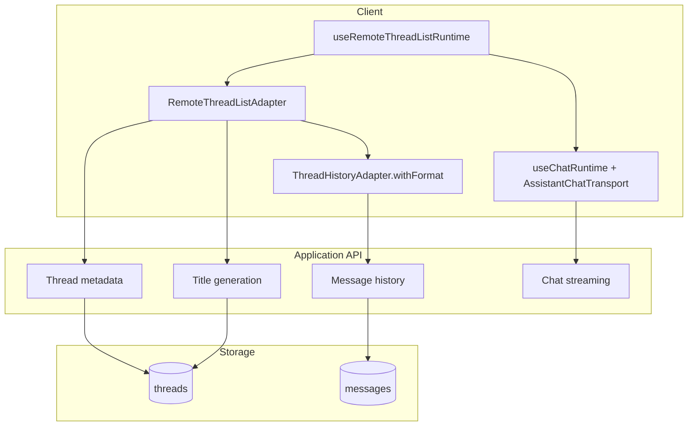
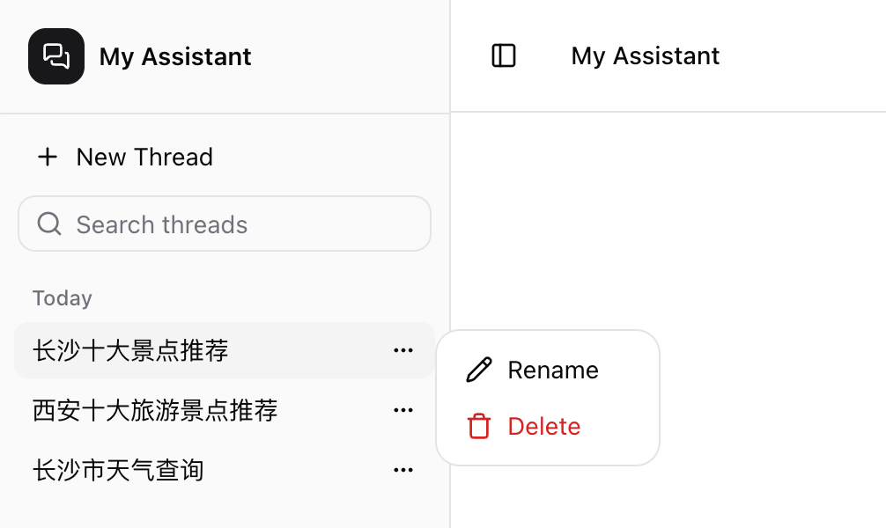

# Assistant-UI 会话历史持久化

上一篇 [Assistant-UI 进阶](/2026/10/10/assistant-ui-advance) 介绍了 Mentions、工具、Generative UI 和 Interactables。随着聊天界面进入真实应用，下一个问题是如何在刷新页面后恢复消息，并让用户创建、切换和管理多个会话。

AI SDK 的 `useChatRuntime` 默认只维护当前页面中的消息。要实现多会话列表、刷新恢复和跨设备同步，可以给 Assistant-UI 接入自定义 Persistence Adapter。

> OpenCode Runtime 自带会话历史持久化，更多详情请参考 [Assistant UI - The composable AI chat UI toolkit](/2026/09/02/assistant-ui#使用-opencode)。

下面讨论 **Assistant-UI + AI SDK** 的自定义持久化。整个方案由三部分组成：

- `RemoteThreadListAdapter`：管理会话元数据，例如列表、创建、重命名、归档和删除；
- `ThreadHistoryAdapter`：加载和追加某个会话中的消息；
- `useRemoteThreadListRuntime`：把多会话管理包在每个会话的 `useChatRuntime` 外层。

本文只关注 Assistant-UI 的 Adapter 和 Runtime 接法，不展开数据库表、鉴权和后台接口。

## 整体架构



## 安装依赖

```sh
$ npm install @assistant-ui/react @assistant-ui/ai-sdk assistant-stream ai
```

`assistant-stream` 用于把自动生成的会话标题包装成 `AssistantStream`。

## Thread List Adapter

`RemoteThreadListAdapter` 负责会话列表，不直接保存消息。下面是示例中的实现，后台请求细节被省略，只保留 Adapter 关心的数据转换：

```tsx
import type { RemoteThreadListAdapter } from "@assistant-ui/react";
import { createAssistantStream } from "assistant-stream";

export const threadListAdapter: RemoteThreadListAdapter = {
  async list() {
    const rows = await threadApi.list();

    return {
      threads: rows.map((thread) => ({
        // remoteId 是持久化层中的会话 ID。
        remoteId: thread.id,
        status: thread.status,
        title: thread.title ?? undefined,
        lastMessageAt: thread.updatedAt
          ? new Date(thread.updatedAt)
          : undefined,
      })),
    };
  },

  async initialize(_localId) {
    // 新 Thread 第一次写消息时才创建远程记录。
    const thread = await threadApi.create();
    return { remoteId: thread.id };
  },

  async rename(remoteId, title) {
    await threadApi.update(remoteId, { title });
  },

  async archive(remoteId) {
    await threadApi.update(remoteId, { status: "archived" });
  },

  async unarchive(remoteId) {
    await threadApi.update(remoteId, { status: "regular" });
  },

  async delete(remoteId) {
    await threadApi.delete(remoteId);
  },

  async fetch(remoteId) {
    // 切换到某个会话时，重新读取它的元数据。
    const thread = await threadApi.get(remoteId);
    return {
      remoteId: thread.id,
      status: thread.status,
      title: thread.title ?? undefined,
      lastMessageAt: thread.updatedAt
        ? new Date(thread.updatedAt)
        : undefined,
    };
  },

  async generateTitle(remoteId, messages) {
    // 标题生成方法必须返回 AssistantStream。
    return createAssistantStream(async (controller) => {
      const { title } = await threadApi.generateTitle(remoteId, messages);
      controller.appendText(title);
    });
  },
};
```

Assistant-UI 内部先给新会话一个本地 ID，真正发送第一条消息时才调用 `initialize()`，并保存返回的 `remoteId`。之后重命名、归档和删除都使用 `remoteId`。

Adapter 应放在模块顶层，或通过 `useMemo` 保持引用稳定。每次渲染都创建新对象会触发会话列表重新加载，并丢弃不在新列表中的缓存 Thread。

## Message History Adapter

会话列表与消息历史是两个独立的 Adapter。AI SDK 使用自己的 `UIMessage` 格式，因此需要实现 `ThreadHistoryAdapter.withFormat(fmt)`，让 Runtime 提供正确的编码器和解码器。

示例将消息保存为四个与 Runtime 无关的字段：

```ts
type StoredMessageRow = {
  id: string;
  parentId: string | null;
  format: string;
  content: Record<string, unknown>;
};
```

- `id`：稳定的消息 ID；
- `parentId`：父消息 ID，用于保留重新生成和编辑产生的分支；
- `format`：消息格式标识；
- `content`：由 `fmt.encode()` 生成的内容。

历史 Adapter 需要知道当前 Thread 的 `remoteId`，因此把它写成一个 Hook：

```tsx
import {
  useAui,
  type ThreadHistoryAdapter,
} from "@assistant-ui/react";
import { useMemo } from "react";

function useThreadListAdapters() {
  const aui = useAui();

  const history = useMemo<ThreadHistoryAdapter>(
    () => ({
      // useChatRuntime 走 withFormat；这两个顶层方法只为满足接口。
      async load() {
        return { messages: [] };
      },
      async append() {},

      withFormat: (fmt) => ({
        async load() {
          const { remoteId } = aui.threadListItem.getState();
          if (!remoteId) return { messages: [] };

          const rows = await messageApi.list(remoteId);

          return {
            // 必须通过当前 Runtime 给出的 fmt 还原消息。
            messages: rows.map((row) =>
              fmt.decode({
                id: row.id,
                parent_id: row.parentId,
                format: row.format,
                content: row.content,
              }),
            ),
          };
        },

        async append(item) {
          // append 可能早于远程 Thread 创建，必须先 initialize。
          const { remoteId } =
            await aui.threadListItem.initialize();

          await messageApi.append(remoteId, {
            id: fmt.getId(item.message),
            parentId: item.parentId,
            format: fmt.format,
            content: fmt.encode(item),
          });
        },

        async update(item, localMessageId) {
          const { remoteId } =
            await aui.threadListItem.initialize();

          await messageApi.update(remoteId, localMessageId, {
            format: fmt.format,
            content: fmt.encode(item),
          });
        },
      }),
    }),
    [aui],
  );

  return useMemo(() => ({ history }), [history]);
}
```

不要自己拼装 `content`，也不要硬编码 `format`。`useChatRuntime` 会提供与当前版本匹配的 `fmt`；写入时使用 `fmt.encode()`，读取时使用 `fmt.decode()`，旧消息才能在升级和重新加载后正确恢复。

`append()` 在新消息完成时追加记录。可选的 `update()` 用于原地更新已经保存的消息，例如补齐运行时间信息，或持久化等待用户审批中的 Tool Call。没有 `update()` 时，页面若在审批完成前刷新，尚未终结的审批状态可能丢失。

## 把 History 注入每个 Thread

`useThreadListAdapters` 是 React Hook，不能直接在模块顶层执行。示例通过 `RuntimeAdapterProvider` 把 History Adapter 注入当前 Thread：

```tsx
import {
  RuntimeAdapterProvider,
  type RemoteThreadListAdapter,
} from "@assistant-ui/react";
import type { ReactNode } from "react";

function ThreadAdapterProvider({
  children,
}: {
  children?: ReactNode;
}) {
  const adapters = useThreadListAdapters();

  // children 必须在第一次渲染时同步返回，不能等待 useEffect。
  return (
    <RuntimeAdapterProvider adapters={adapters}>
      {children}
    </RuntimeAdapterProvider>
  );
}

export const threadListAdapter: RemoteThreadListAdapter = {
  // list、initialize、rename、archive 等方法……

  // Store 形式的 Host 可以直接调用这个 Hook。
  unstable_useAdapters: useThreadListAdapters,

  // useRemoteThreadListRuntime 使用这个 Provider 包裹活动 Thread。
  unstable_Provider: ThreadAdapterProvider,
};
```

`unstable_Provider` 必须在首次 Commit 时直接渲染 `children`，不能把它放在 Suspense、加载状态或 `useEffect` 后面。消息加载工作应该放在 `history.load()` 中。

官方同时支持只提供 `unstable_useAdapters`：当 `unstable_Provider` 缺失时，`useRemoteThreadListRuntime` 会直接调用这个 Hook。示例同时提供两种入口，使 Adapter 也能用于其他 Assistant-UI Host。

## 使用 `useRemoteThreadListRuntime`

最后用 `useRemoteThreadListRuntime` 包装原来的 `useChatRuntime`：

```tsx
"use client";

import {
  AssistantRuntimeProvider,
  useRemoteThreadListRuntime,
} from "@assistant-ui/react";
import {
  AssistantChatTransport,
  useChatRuntime,
} from "@assistant-ui/ai-sdk";
import { lastAssistantMessageIsCompleteWithToolCalls } from "ai";
import { Thread } from "@/components/assistant-ui/thread";
import { ThreadListSidebar } from "@/components/assistant-ui/threadlist-sidebar";
import { threadListAdapter } from "@/lib/assistant/thread-adapter";

export function Assistant() {
  const runtime = useRemoteThreadListRuntime({
    // 每个 Thread 都拥有独立的 AI SDK Runtime。
    runtimeHook: () =>
      useChatRuntime({
        transport: new AssistantChatTransport({
          api: "/api/chat",
        }),
        sendAutomaticallyWhen:
          lastAssistantMessageIsCompleteWithToolCalls,
      }),
    // 外层 Runtime 负责加载、创建和切换 Thread。
    adapter: threadListAdapter,
  });

  return (
    <AssistantRuntimeProvider runtime={runtime}>
      <ThreadListSidebar />
      <Thread />
    </AssistantRuntimeProvider>
  );
}
```

`runtimeHook` 会为每个 Thread 创建一个 `useChatRuntime`。用户切换会话时，外层 Runtime 先通过 `RemoteThreadListAdapter.fetch()` 确认元数据，再由对应 Thread 的 `history.load()` 恢复消息。

`ThreadListPrimitive` 或示例中的 `ThreadListSidebar` 会直接读取这个 Runtime，无需自己维护当前 Thread ID。

## 持久化过程

一次新会话从创建到恢复会经历以下过程：

1. `RemoteThreadListAdapter.list()` 加载已有会话；
2. 用户点击新建，Runtime 先创建一个本地 Thread；
3. 用户发送第一条消息，`history.append()` 调用 `threadListItem.initialize()`；
4. `initialize()` 创建远程会话并返回 `remoteId`；
5. `fmt.encode()` 把 User、Assistant 和 Tool Call 消息转换后写入 History；
6. 页面刷新后，`list()` 恢复会话列表；
7. 用户打开会话，`history.load()` 读取记录并通过 `fmt.decode()` 还原消息。

这里最容易遗漏的是第 3 步。`append()` 可能比远程会话创建更早触发，因此必须等待 `initialize()`；这个方法可以安全重复调用，并且总会返回当前 Thread 的同一个 `remoteId`。

本文省略了数据表、接口和鉴权实现。完整可运行代码请参考 [assistant-ui-demo](https://github.com/cp3hnu/assistant-ui-demo) 中的 `lib/assistant/thread-adapter.tsx`。

## 实现效果



## Demo

- [GitHub - assistant-ui-demo](https://github.com/cp3hnu/assistant-ui-demo)

## References

- [Custom thread persistence](https://www.assistant-ui.com/docs/integrations/persistence/custom-adapter)
- [Threads](https://www.assistant-ui.com/docs/runtimes/concepts/threads)
- [Assistant-UI 进阶](/2026/10/10/assistant-ui-advance)
